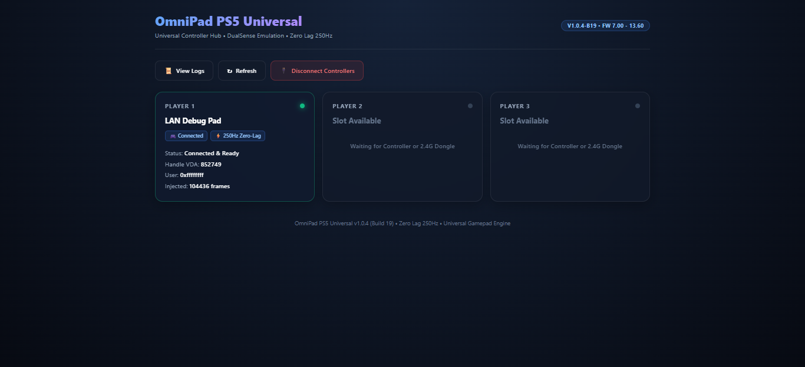

# Python Gamepad to PS5 Controller Bridge

A lightweight Python bridge that reads input from a USB gamepad connected to a Windows PC and forwards controller input to an **OmniPad PS5 device over a local network**.

The goal is to use a laptop-connected USB gamepad as an input device for a PS5 through OmniPad.

## How It Works

```text
USB Gamepad
    |
    v
Windows PC
    |
    v
Python + Pygame
    |
    v
TCP Connection (LAN)
    |
    v
OmniPad PS5
    |
    v
PlayStation 5
```

The Python script:
- Detects and reads a connected gamepad using Pygame.
- Reads button presses, analog sticks, triggers, and D-pad input.
- Converts controller state into the binary input frame expected by the OmniPad TCP test-input interface.
- Sends input frames to OmniPad over the local network.
- Maintains the connection by retrying after transmission errors.
- Logs controller state and connection activity.
- Supports monitor-only mode for inspecting controller input without transmitting it.
- Supports a button-sweep diagnostic for testing input bits.

## Requirements

- Windows PC
- Python 3.12 or compatible Python 3.x installation
- USB gamepad connected to the PC
- PS5 console
- OmniPad PS5 v1.0.4 installed and running
- PC and OmniPad connected to the same local network

## Python Dependencies

Install Pygame:

```bash
python -m pip install pygame
```

Or install from requirements:

```bash
pip install -r requirements.txt
```

## Configuration

Open the Python script and update the configuration values to match your network and setup.

| Setting | Description |
|---|---|
| `PS5_IP` | IP address of the OmniPad device |
| `OMNIPAD_INPUT_PORT` | TCP input port |
| `OMNIPAD_DASHBOARD_PORT` | OmniPad dashboard port |
| `CONTROLLER_INDEX` | Pygame controller device index |
| `SEND_RATE_HZ` | Controller input transmission frequency |
| `CONNECT_TIMEOUT_SECONDS` | TCP connection timeout |
| `RETRY_DELAY_SECONDS` | Delay before retrying after an error |
| `HEARTBEAT_SECONDS` | Logging heartbeat interval |

Default configuration used during testing:

```python
PS5_IP = "192.168.1.100"
OMNIPAD_INPUT_PORT = 9045
OMNIPAD_DASHBOARD_PORT = 8095
CONTROLLER_INDEX = 0
SEND_RATE_HZ = 20.0
```

**Important:** These are example values from the development setup. Change the IP address to match your own OmniPad device.

## Running the Bridge

1. Connect your USB gamepad to your Windows PC.
2. Make sure OmniPad is running on the PS5.
3. Confirm that the PC and OmniPad are connected to the same network.
4. Update the IP address and controller configuration in the Python script.
5. Run:

```bash
python omnipad_gamepad_bridge.py
```

Use `--help` to see the command-line options supported by the script:

```bash
python omnipad_gamepad_bridge.py --help
```

Useful CLI flags:
- `--list-devices`: List all detected gamepads and their indices.
- `--monitor`: Read and display gamepad inputs without sending TCP frames to the PS5.
- `--sweep`: Run an automated button bit sweep test.
- `--host <IP>`: Override PS5 IP address.
- `--port <PORT>`: Override OmniPad TCP port (default: 9045).

Press `Ctrl+C` to stop the bridge.

## OmniPad Connection Details

The implementation uses the following OmniPad interfaces:

| Interface | Port | Purpose |
|---|---:|---|
| Web Dashboard | 8095 | OmniPad dashboard |
| TCP Input | 9045 | Controller input frames |

Dashboard:

```text
http://192.168.1.100:8095/
```



The TCP input interface is used to transmit controller frames. The script uses a 16-byte frame format:

```python
FRAME_FORMAT = "<I6B6x"
FRAME_LENGTH_BYTES = 16
```

## Controller Configuration

Controller button and axis mappings are configurable in the Python script.

The mapping is handled through:

- `BUTTON_MAP`
- `AXIS_MAP`
- `BUTTON_MASKS`

This allows different USB gamepads to be configured without changing the underlying network transmission logic.

**Note:** Controller button numbering can differ between devices. Verify the mappings for your own controller before using the bridge (use `python omnipad_gamepad_bridge.py --monitor`).

## Diagnostics and Monitoring

The script includes diagnostic functionality to help troubleshoot:

- Controller detection
- Button and axis input
- TCP connectivity
- Input frame transmission
- Connection errors
- Button-bit testing

Monitor-only mode can be used to inspect controller input without sending frames to OmniPad.

## Current Status

The project has been tested with:

- Windows
- Python 3.12
- Pygame
- A USB gamepad detected through Pygame
- OmniPad PS5 v1.0.4
- LAN communication using TCP port 9045

The bridge has successfully established TCP communication with OmniPad and transmitted controller input frames during testing.

Actual gameplay compatibility and complete button functionality can depend on the controller mapping, OmniPad configuration, and PS5 environment.

## Known Limitations

- The project currently uses a TCP test-input interface rather than directly pairing the laptop's USB gamepad with the PS5.
- Controller mappings may need adjustment for different USB gamepads.
- Direct Bluetooth support is not implemented by this Python bridge.
- The project depends on a compatible OmniPad installation and its input protocol.
- PS button and profile-selection behavior should be verified on the actual PS5 hardware.

## Disclaimer

This is an independent community project and is not affiliated with, endorsed by, or officially supported by Sony Interactive Entertainment or the OmniPad developers.

PlayStation, PS5, and OmniPad are referenced only to identify the hardware and software this project is designed to work with.

## License

This project is licensed under the MIT License. See the [LICENSE](LICENSE) file for details.

